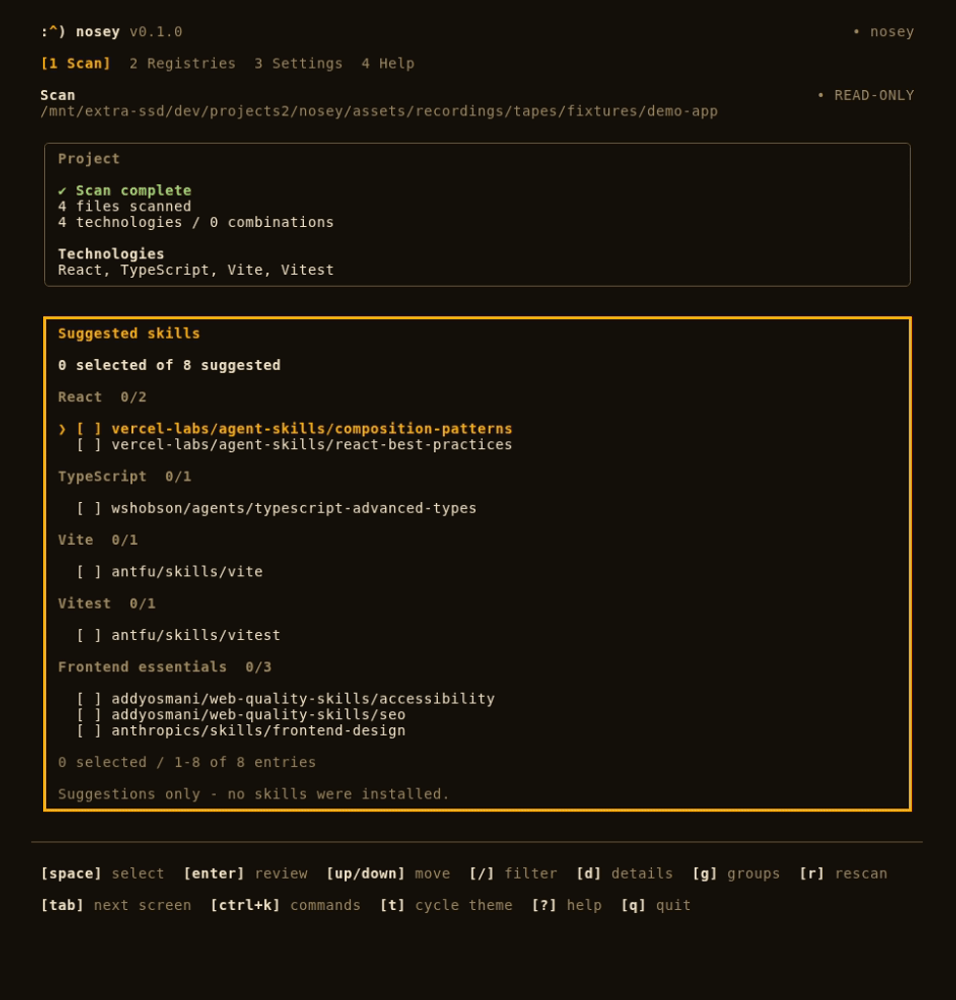
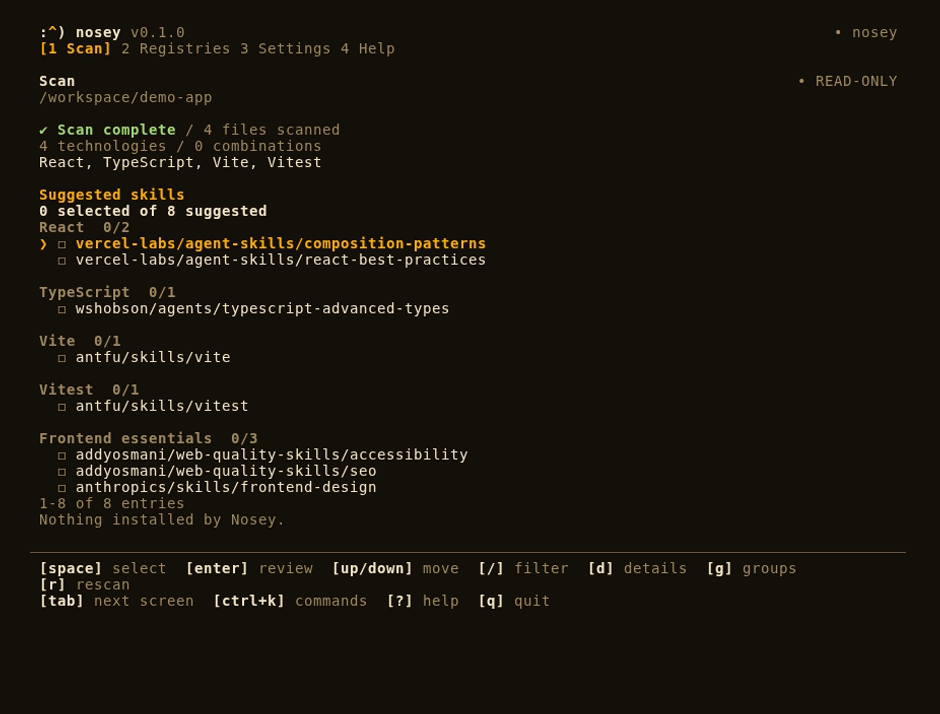
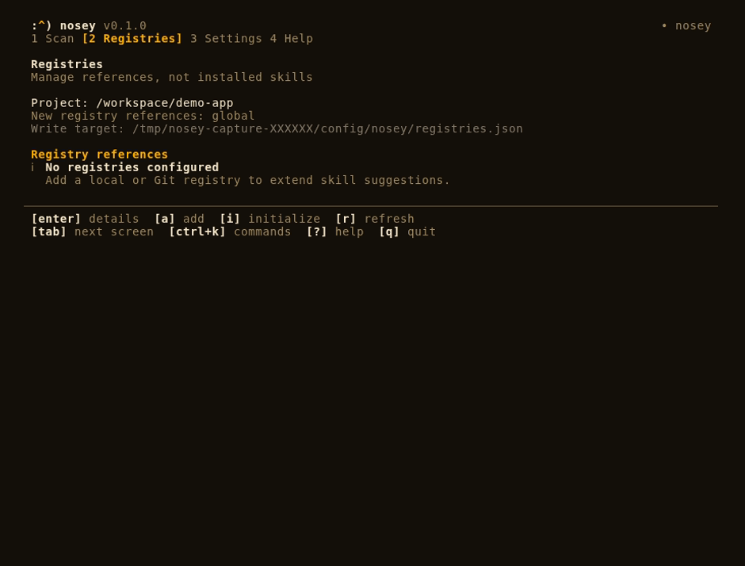
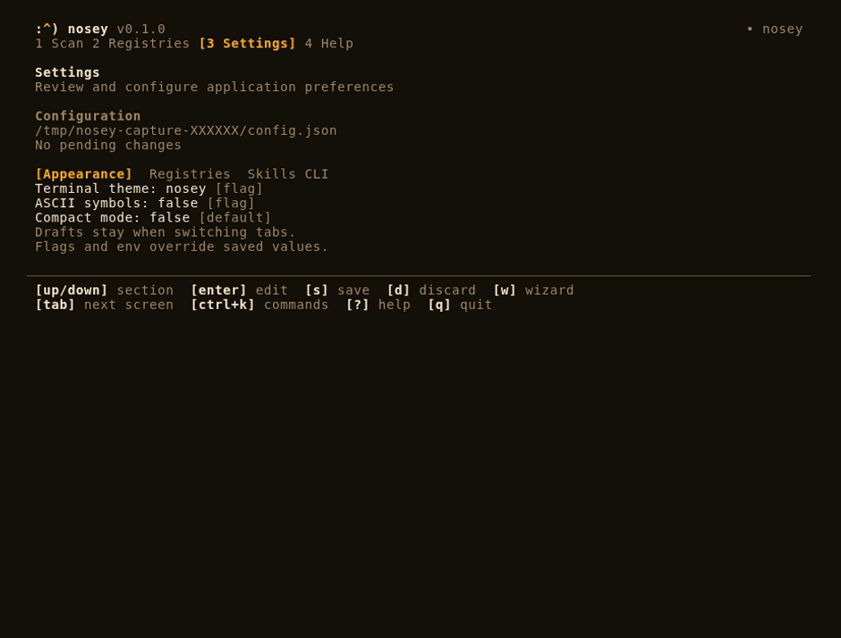
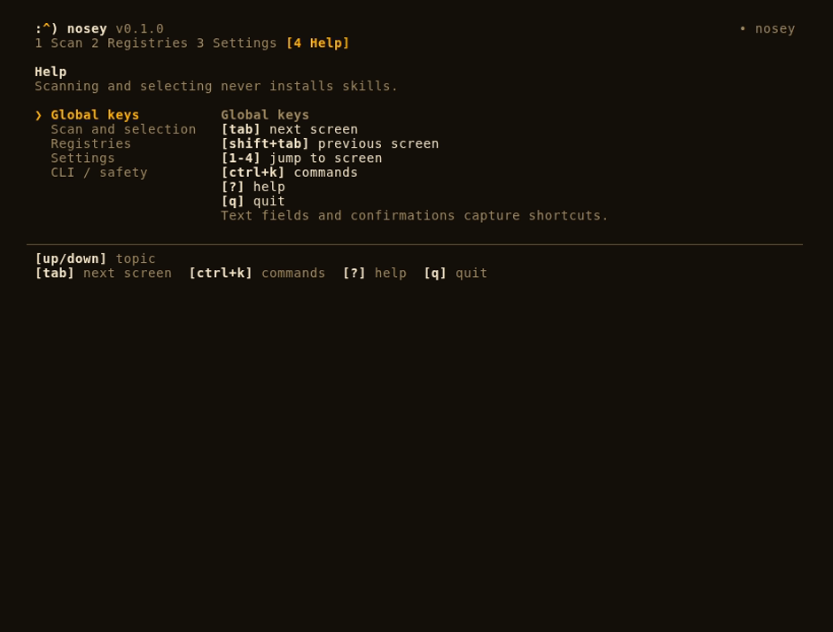

<div align="center">
  <h1>
    <picture>
      <source media="(prefers-color-scheme: dark)" srcset="assets/nosey-brand-kit/svg/logo/nosey-logo-for-dark.svg">
      
    </picture>
  </h1>

  <p><strong>Find agent skills that match the technologies in your workspace.</strong></p>
  <p>Nosey scans project files, groups matching skill suggestions, and lets you review them in an interactive terminal. Scanning and selecting never install skills.</p>

  <p>
    
    
    
  </p>

  <p>
    <a href="#quick-start">Quick start</a> ·
    <a href="#terminal-workflow">Terminal workflow</a> ·
    <a href="#screenshots">Screenshots</a> ·
    <a href="#cli-and-automation">CLI and automation</a> ·
    <a href="#development">Development</a>
  </p>
</div>

<div align="center">
  <a href="assets/recordings/home-nosey-100-video.mp4">
    
  </a>
  <p><sub>Slow Scan + Registries demo · <a href="assets/recordings/home-nosey-100-video.mp4">Watch MP4</a> · <a href="assets/recordings/home-nosey-100-video.png">View still frame</a></sub></p>
</div>

## Quick start

Requires **Node.js 24+**. Run Nosey from this repository; a published package installation is not assumed.

```bash
git clone https://github.com/rigerc/nosey.git
cd nosey
npm ci
npm run dev -- ../your-project
```

In an interactive terminal, Nosey opens **Scan** for the supplied directory. Omit the path to scan the current directory.

To get a text report instead of opening the interface:

```bash
npm run dev -- scan ../your-project --explain
```

Nosey reads manifests and configuration signals without executing the scanned project's code. It reports detected technologies, matching agent skills, and supporting evidence. Installing recommended skills requires enabling Skills CLI execution and confirming a selection.

## Terminal workflow

Navigate four tabs in one terminal session:

| Tab            | What you can do                                                                                           |
| -------------- | --------------------------------------------------------------------------------------------------------- |
| **Scan**       | See detected technologies and grouped suggestions, filter results, inspect details, and select skill IDs. |
| **Registries** | Manage local and Git-based skill registry references, inspect their contents, and initialize a registry.  |
| **Settings**   | Preview themes and adjust appearance or configuration with save/discard controls.                         |
| **Help**       | Look up shortcuts and available actions.                                                                  |

### Essential keys

| Keys                           | Action                              |
| ------------------------------ | ----------------------------------- |
| `Tab` / `Shift+Tab` or `1`–`4` | Switch tabs                         |
| `Ctrl+K`                       | Open the command menu               |
| `↑` / `↓` or `j` / `k`         | Move through Scan suggestions       |
| `/` or `f`                     | Filter Scan suggestions             |
| `c`                            | Clear the Scan filter               |
| `Space`                        | Select or deselect a skill          |
| `d`                            | View skill details in Scan          |
| `Enter`                        | Review selected skill IDs           |
| `?`                            | Open Help                           |
| `q`                            | Quit without confirming a selection |

Selections stay intact when you filter results or switch tabs. Confirming the selection prints distinct skill IDs after the terminal UI exits. Confirmation defaults to **No**.

### Optional Skills CLI commands and execution

Open **Settings → Skills CLI** to enable installation command generation and select one or more default agents. This feature is **off by default**. After selecting skills, Scan previews project-local commands. By default, confirming prints copy-pasteable commands only after the terminal UI exits.

Enable **Settings → Skills CLI → Execute Skills CLI commands** to run the reviewed commands for you. Execution is **off by default** and requires command generation to be enabled. Save and relaunch to apply settings. Both full and compact Scan show the commands, project directory and agents before asking **Install selected skills and exit?**, defaulting to **No**. After confirmation, Nosey exits the UI and runs commands sequentially in the scanned directory, showing Skills CLI output and a completion summary. npm may download Skills CLI without a further prompt. A failure stops the remaining commands and returns a nonzero exit status; Ctrl+C cancels execution. Completed commands are not rolled back.

```bash
cd /path/to/your-project && npx skills add vercel-labs/agent-skills --skill react-best-practices --agent claude-code --agent codex --yes --json
```

The generated commands always use the scanned project directory, include `--yes --json`, and never use `--global`. **Printing commands does not install skills. Enabling execution and confirming the selection installs them.** Multiple repositories or differing agent requirements yield multiple commands.

Scan also checks project-local skill directories and `skills-lock.json` without launching the Skills CLI. Skills with matching lock provenance and local files are marked **Installed** (all inspected agents) or **Partial** (some agents). Matching file names without verified provenance are marked **Present (unverified)**; Nosey will not silently treat them as installed. Global installations do not count. Skills marked **Installed** start selected in both Scan views; Space can deselect them. A rescan resets the selection to the newly detected installed skills. Fully installed targets are omitted from generated commands; partially installed skills target only missing agents.

## Screenshots

These tracked captures use the Nosey terminal theme. Scan shows a demo React, TypeScript, Vite, and Vitest workspace. The Registries image shows the initial state before references are added.

<table>
  <tr>
    <td width="50%" valign="top">
      
      <p><sub><strong>Scan</strong> · Technology groups and selectable skill suggestions</sub></p>
    </td>
    <td width="50%" valign="top">
      
      <p><sub><strong>Registries</strong> · Project scope and reference management</sub></p>
    </td>
  </tr>
  <tr>
    <td width="50%" valign="top">
      
      <p><sub><strong>Settings</strong> · Appearance preferences and save/discard actions</sub></p>
    </td>
    <td width="50%" valign="top">
      
      <p><sub><strong>Help</strong> · Keyboard shortcuts in the app</sub></p>
    </td>
  </tr>
</table>

## CLI and automation

The same detection engine works without the interactive interface, including in pipes and CI.

```bash
# Human-readable report with detection evidence
npm run dev -- scan ../your-project --explain

# Structured report
npm run dev -- scan ../your-project --json

# Suggested skill IDs only
npm run dev -- scan ../your-project --skills-only

# Scan with a custom bound
npm run dev -- scan ../your-project --depth 6 --max-files 5000

# Diagnostics
npm run dev -- doctor --json
```

The explicit `scan` subcommand is always headless. A project path alone opens the UI in a TTY; `--json`, `--skills-only`, `--plain`, `--no-interactive`, and non-TTY environments use noninteractive output.

Use `npm run dev -- --help` for the complete command and option reference.

### Skill registries

Add local folders or Git repositories as sources of recommendations:

```bash
npm run dev -- registry add ./team-skills
npm run dev -- registry add https://github.com/org/skills.git --ref v1
npm run dev -- registry list --json
npm run dev -- registry validate ./team-skills --json
```

### Refreshing Git registries

Normally Git registries use a cached snapshot for up to 24 hours. To **force a network
refresh** of all configured Git registries without waiting for the cache TTL:

```bash
npm run dev -- registry refresh
npm run dev -- registry refresh --json
```

Refresh a specific Git URL and revision (even when it isn't configured):

```bash
npm run dev -- registry refresh https://github.com/org/skills.git --ref main
```

The command reports `initialized` (first fetch), `updated` (cached revision
changed), `unchanged`, `cached` (network failure with a previous snapshot), or
`error`. Network failures use a nonzero exit code. It never runs registry code
or installs skills.

**Settings → Registries → Check Git registries on startup** is off by default.
When enabled, an interactive launch forces one Git update check as part of the
initial scan, regardless of the cache TTL. If a previously cached Git revision
changed, Nosey displays the affected sources. With **Skills CLI** enabled, it
also suggests running `npx skills update` yourself. The startup check and update suggestion remain advisory, including when Skills CLI execution is enabled; run the update command yourself. Ordinary
headless scans continue to use the configured registry TTL.

To create a registry in a **new** directory, Nosey downloads the default branch of
[rigerc/nosey-registry-template](https://github.com/rigerc/nosey-registry-template)
at one resolved commit. Network access is required, including with `--no-git`
(which needs neither Git nor `gh`):

```bash
npm run dev -- registry init ./team-skills --registry-id acme/team-skills --yes --no-git
```

Registries may declare external skills in `skills-map.json` version 2 and map them to detected technologies without storing their `SKILL.md` files. The upstream source is retained for opt-in install command generation. Registry changes are separate from scanning and skill selection. Added registry references are saved globally (under your user config directory), so they are available when scanning any project. Existing project-scoped references remain supported for compatibility; remove a legacy reference with `registry remove <source> --project`. The interactive manager shows write targets and requests confirmation. Git registries are read through Git objects without executing remote code. See `npm run dev -- registry --help` for available subcommands, or `npm run dev -- --help` for the main CLI help.

For a GitHub registry, use `registry init ./team-skills --registry-id acme/team-skills --github --yes`.
Interactive initialization prefills the owner from the signed-in `gh` account and
the repository name from the destination folder. Edit the suggestion as needed;
if `gh` is unavailable, enter the identity manually. An explicit `--registry-id`
always takes precedence.
Nosey checks Git, `gh` authentication, the template, and the destination repository,
then creates a **private** repository using GitHub's template mechanism. Use
`--visibility public` to publish publicly. It clones the generated repository,
configures identity with Nosey's packaged tools, validates, commits, and pushes the
current branch. Template history and `origin` are retained. Local creation instead
starts fresh Git history with no upstream remote; `--no-git` leaves no `.git`.

**GitHub creates the remote before local setup finishes.** If cloning, configuration,
commit, or push fails, the error reports completed stages and recovery commands.
Keep the remote and useful clone; follow those instructions instead of repeating
`registry init --github`. An uncertain creation response is never treated as permission
to adopt an existing repository. Initializing never runs downloaded registry scripts.

Nosey validates registry JSON using its supported `schemaVersion` values before
and after configuration. Existing registries and offline `registry build` do not
need a template download.

JSON Schemas stay in Nosey under `schemas/registry/`; the template does not include
them or `$schema` annotations. See the
[registry schema reference](docs/registry-schema.md) for the document fields and
parser-only rules.

The template's existing monthly sync workflow proposes maintenance updates through
reviewed PRs. Enable Actions and allow Actions to create pull requests in repository
settings. Sync excludes registry identity, mappings, generated output, skills, and
workflows; review those separately and regenerate output after accepting tool updates.
See [template maintenance](docs/registry-contract.md) for the single-command tools
sync workflow.

## Appearance

Five themes are available: `nosey`, `dark`, `light`, `contrast`, and `mono`. The terminal can also use ASCII symbols and borders.

```bash
npm run dev -- ../your-project --theme nosey
npm run dev -- ../your-project --theme contrast --ascii
npm run dev -- --setup
```

Settings are saved only when you choose to save them. Theme previews do not change saved preferences.

**Compact mode** is an optional toggle in Settings (off by default). When enabled, launching the interactive Scan directly with `nosey [path]` opens a minimal interface without application tabs or the command menu. You can still select skills with Space, review them with Enter, rescan with `r`, or quit with `q`. The compact Scan supports the same opt-in Skills CLI command printing or execution and installed status labels as the full Scan. Launches that start on another screen retain the standard interface. The explicit `nosey scan [path]` command, `--plain`, and noninteractive reports remain headless and unchanged. Restart Nosey after saving this setting.

## Development

Build the CLI, then run it without the development runner:

```bash
npm run typecheck
npm test
npm run build
npm run start -- ../your-project
```

You can also run `npm link` after building to use the `nosey` executable locally.

### Linting

```bash
npm run lint   # Vite+ / Oxlint, including anti-slop rules
npm run check  # Full Vite+ format, lint, and type checks
```

Anti-slop's generic rules are enabled at error severity in `vite.config.ts`.
The plugin is vendored in `tools/oxlint/anti-slop/`; its `UPSTREAM.md` records the
exact source revision and update requirements. Keep `@oxlint/plugins` pinned to
the Oxlint version used by Vite+ when upgrading. The optional Effect rules are
not enabled because this project does not depend on Effect.

CI runs both checks and rejects lint warnings. The pre-commit hook also runs `vp check --fix` on staged files; review its diagnostics
when changing source. Installed agent tooling and the vendored plugin are excluded
from linting and formatting.

### Capture the terminal UI

The repository includes a [VHS-based recording workflow](docs/recording.md) and an editable [interaction tape](scripts/tapes/workflow.tape).

```bash
# Static screenshots in the default capture matrix
npm run screenshot

# Interactive journey exported as GIF and MP4
npm run record

# Use the tracked Nosey theme and 96-column layout
npm run screenshot -- --theme nosey --columns 96
```

Capture tooling requires VHS, ttyd, FFmpeg, and Chromium. The demo GIF, MP4, and still frame above are checked into [`assets/recordings/`](assets/recordings/). Static captures go to [`assets/screenshots/`](assets/screenshots/); recordings go to `assets/recordings/`. Replay tapes and fixtures are ignored. Review and commit refreshed media to update the README. The [capture workflow](.github/workflows/screenshots.yml) uploads media as CI artifacts.

For internals and extensions, see [Architecture](docs/architecture.md), [UI framework](docs/ui-framework.md), and [Add a feature](docs/adding-a-feature.md). The catalog and skill-mapping utilities are documented in [scripts/README.md](scripts/README.md).

## Notices

See [THIRD_PARTY_NOTICES.md](THIRD_PARTY_NOTICES.md) for the imported SkillSense engine's provenance and third-party license information.
